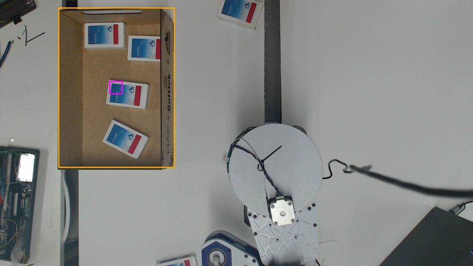
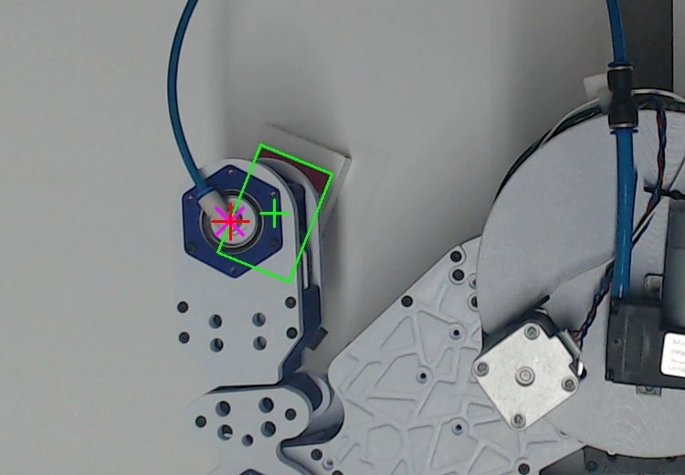
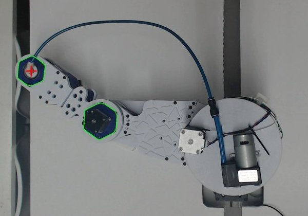

# SCARA pick and place com visão

Controle de um braço **SCARA** que acha caixas de remédio com uma câmera de cima, lê o nome delas,
leva a ventosa até o centro da caixa, pega e solta dentro de uma caixa coletora, sempre conferindo
a posição da ponta pela câmera.



Este repositório reúne o código que liga as duas partes que já existiam:

| Projeto | Papel |
|---|---|
| [ScaraNode](https://github.com/danielmtorres7/scaranode) | placas RP2040 + TMC2209/DM556 com o firmware `painel` (JSON pela USB) |
| `only-vision` | visão com Gemini + OpenCV: acha as caixas e **lê o nome** de cada uma |
| **este repositório** | calibração câmera ↔ robô, cinemática, movimento sincronizado, pick and place |

## O que o código faz

1. **Fala direto com as placas** pela USB, com o mesmo protocolo do painel web (`scara.py`). As placas
   são achadas pelo número de série USB, então a porta COM pode mudar sem problema.
2. **Move J1 e J2 juntos.** Monta um perfil trapezoidal sincronizado, em que as duas juntas começam e
   terminam juntas, e o envia como trajetória de segmentos de 10 ms (`tjini`/`tj`), do mesmo jeito
   que o painel faz para desenhar.
3. **Sabe onde está a ponta.** Encontra na imagem o hexágono azul do rolamento da ponta (a ventosa
   fica logo abaixo dele) e acha o centro do anel do rolamento com transformada de Hough (`ponta.py`).
4. **Converte pixel em mm e em ângulos.** Usa um modelo câmera + braço calibrado (`modelo.py`) que
   compensa a **paralaxe**: a câmera fica inclinada, a ~85 cm, e a ponta, a caixa e a mesa estão em
   alturas diferentes.
5. **Acha as caixas** só com OpenCV (`caixa.py`). A impressão colorida serve de semente, e o código
   cresce até a borda branca da caixa. Caixas encostadas ficam separadas.
6. **Lê o nome** das caixas com o Gemini do `only-vision` (uma chamada por ciclo) e associa cada nome
   à caixa do OpenCV mais próxima. Aceita um erro de leitura (por exemplo, "Miopure" = "Micpure").
7. **Faz o pick and place** (`pick_place.py`). Cada caixa passa por estas etapas: subir acima da
   coletora, ir até a caixa, descer até a altura de mira, conferir pela câmera e corrigir, descer e
   pegar (a bomba liga), subir, ir até a coletora, descer e soltar (a bomba desliga; em repouso ela fica desligada). O código também:
   - **evita colisão**: na hora da pega, escolhe a posição do cotovelo que deixa o braço longe da
     parede da coletora;
   - **para tudo** se uma placa avisar de reinício do TMC, queda do 24 V ou fim de curso acionado
     fora de hora.



## Como foi feito

Tudo foi calibrado **olhando o robô pela câmera** enquanto ele se movia, devagar no começo e mais
rápido depois de cada teste:

1. **Sentido e passos de cada eixo.** O J1 girou 5° e a imagem girou 5,00° (medido com ORB, que
   casa pontos entre duas fotos, e uma transformação afim). Assim ficaram confirmados os passos por
   grau, o sentido (J1+ e J2+ anti-horários vistos de cima) e o pixel do eixo do J1.
2. **Detector da ponta.** Primeiro pelo hexágono azul. Depois o critério passou a ser o "centro
   claro" (o engate branco), porque o cotovelo também tem um hexágono azul, mas com o motor escuro no
   meio. Por fim vem o refinamento pelo anel do rolamento.
3. **Grade de calibração.** São 63 poses (J1 de -110° a -30°, J2 de -110° a +10°), cada uma em 2
   alturas de Z. Com L1 = 300 mm e L2 = 200 mm (medidos), o `calibrar.py` ajusta por mínimos quadrados
   robustos uma **matriz de projeção 3×4** (câmera pinhole) e o **zero do J2**. Resultado: **2,5 px de
   erro mediano (~1,5 mm)**. Com a matriz 3×4 dá para converter pixel em mm em qualquer altura, que é
   o que resolve a paralaxe.
4. **Alturas.** O Z é referenciado pelo fim de curso de cima. A altura em que a ventosa encosta na
   mesa foi medida com régua.
5. **Limites achados nos testes**, todos com conferência pela câmera:
   - **Z:** perde passo subindo acima de ~45 mm/s, por isso fica em 45 mm/s.
   - **J2:** abaixo de -112° o antebraço bate na coluna do Z, por isso foi limitado em -112°.
   - **J1/J2:** 900/800 rpm no motor funcionam. A aceleração passou de 120 para 60 °/s² depois que
     a bomba foi montada no antebraço.
6. **Folga mecânica** de ~2–3 mm, que depende do lado por onde a ponta chega. Ela é compensada pela
   correção com a câmera em cada pega: o erro cai de 5–12 mm para 0,5–2,5 mm.



## Hardware

| Eixo | Placa | Driver | Redução | Observação |
|---|---|---|---|---|
| J1 (base, 360°) | ScaraNode v18 | DM556 + NEMA 23 | 14:1 | **sem fim de curso**: o zero é o da hora em que a placa ligou |
| J2 (cotovelo) | a mesma placa (modo "dois") | TMC2209 | 12:1 | limitado a -112° (colisão com a coluna) |
| Z | ScaraNode v18 | TMC2209 | fuso de 8 mm/volta | fins de curso em cima e embaixo |
| Bomba de vácuo | RP2040-Zero | relé no GP4 | — | comandada pelo REPL do MicroPython |

Câmera: Logitech C920 de cima, 1920×1080 (MJPG). No Linux o `cam.py` acha a C920 pelo nome
(`/sys/class/video4linux`) e abre com V4L2; no Windows usa DirectShow, índice 1.

## Instalação

Requer Python 3.10+ e as placas com o firmware `painel` do ScaraNode.

```bash
uv sync                    # ambiente + dependências (pyproject.toml)
uv sync --extra nomes      # + Gemini, para --nome / --ordem
uv run pytest              # testes
# sem uv: pip install -r requirements.txt
```

No Linux, se der "Permission denied" em `/dev/ttyACM*` ou `/dev/video*`, coloque o usuário nos grupos `dialout` e `video`.

Para escolher caixas pelo nome, clone o `only-vision` **ao lado** desta pasta (`../only-vision`) e
coloque a chave do Gemini no `.env` **dele** (`GEMINI_API_KEY=...`). Este repositório não guarda
nenhuma chave.

```
scaranode/
├── controle/       ← este repositório
└── only-vision/    ← visão (Gemini), com o .env da chave
```

## Uso

```bash
python pick_place.py                              # todas as caixas visíveis -> coletora
python pick_place.py --nome micpure               # só as caixas desse remédio
python pick_place.py --ordem arpadol,micpure      # todas da lista, nessa ordem
python pick_place.py --nome micpure --alvo-px 718,1105   # caixa indicada à mão (ex.: cortada na borda da imagem)

python diagnostico.py --corrigir   # re-zera J1/J2 pela câmera e o Z pelo fim de curso (depois de bater, perder passo...)
python bomba.py liga|desliga|firmware
python ir_caixa.py                 # só leva a ventosa ao centro de uma caixa e confere
python calibrar.py                 # refaz o ajuste a partir de dados_grade.json
```

As alturas e as folgas ficam no topo de `pick_place.py` (`Z_PEGA`, `Z_SOLTA`, `ALTURA_COLETORA`...),
e as velocidades no topo de `scara.py`.

## Integração com o EMR (ordem de serviço)

O sistema EMR (repositório `Software-Challenge-3EMR`) lança a OS e o braço a executa de verdade, devolvendo a
contagem real de caixas soltas na coletora.

```bash
uv run python servidor_os.py --porta 8770
```

Sem variáveis de ambiente: com o sistema e o braço no mesmo notebook, abra o sistema, clique em **Braço** no
cabeçalho, escolha o separador que é o braço, mantenha o endereço `127.0.0.1:8770` e clique em **Conectar**. O
sistema gera um token e manda para o braço (`POST /conectar`, aceito só da própria máquina), que guarda em
`braco_conexao.json` e passa a usar o endereço do sistema que veio junto. A tela do ESP32 continua no botão
**ESP32** (porta serial).

1. O EMR faz `POST /os` com `{"os", "cliente", "quantidade", "separadas", "itens": [{"nome", "quantidade", ...}]}`.
   O braço responde 202 e trabalha em segundo plano (uma OS por vez; a mesma OS de novo = retomada).
2. Foto da mesa, nomes pelo Gemini, fila na ordem e na quantidade pedidas (`selecao.py`).
3. A cada caixa solta: `POST <sistema>/api/robo/<os>/evento {"tipo": "unit", "separadas": N}`. A resposta traz o estado da OS:
   pausada = o braço termina a caixa, estaciona e espera; cancelada/concluída = encerra.
4. Faltou caixa na mesa: evento `faltando` e o EMR pausa com "Remédios faltando: …". Reponha e retome: nova foto,
   só o que falta.
5. Erro (placa, fim de curso, 24 V): o braço para, avisa `erro` (o EMR pausa) e solta as portas. Rode
   `diagnostico.py --corrigir` e retome a OS no sistema.

O progresso por remédio fica em `os_progresso.json`, então o braço continua de onde parou se o processo cair.
Rode o servidor de dentro desta pasta (as fotos vão para `fotos/`).

## Arquivos

| Arquivo | O que faz |
|---|---|
| `scara.py` | placas (JSON pela USB), eixos, movimento de um eixo, **trajetória sincronizada J1+J2**, referência do Z |
| `modelo.py` | câmera (projeção 3×4) ↔ robô (mm) ↔ ângulos; cinemática direta e inversa com filtro de colisão |
| `calibrar.py` | ajuste do modelo a partir da grade (`dados_grade.json` → `calibracao_braco.json`) |
| `ponta.py` | detecção da ponta (hexágono + anel do rolamento) |
| `caixa.py` | detecção das caixas de remédio (OpenCV) |
| `pick_place.py` | ciclo completo, caixa coletora, colisão, nomes pelo Gemini, relé |
| `diagnostico.py` | mede pela câmera quanto J1/J2 saíram do modelo e corrige |
| `bomba.py` | relé da bomba de vácuo |
| `servidor_os.py` | recebe a OS do EMR (HTTP) e roda o job |
| `job_os.py` | executa a OS: pausa, faltando, cancelamento, erro, aviso ao sistema |
| `selecao.py`, `progresso.py`, `sistema.py`, `conexao.py` | escolha das caixas, progresso salvo, cliente do EMR, conexão feita pela tela do sistema |
| `cam.py`, `medir_rot.py`, `ir_caixa.py` | câmera, medida de rotação entre fotos, teste de ir até uma caixa |

## Limitações conhecidas

- **A calibração depende do zero do J1**, que não tem fim de curso. Se as placas reiniciarem ou os
  motores forem soltos, rode `diagnostico.py --corrigir`, desde que o braço ainda apareça na imagem.
- O fim de curso de baixo do Z para a ventosa ~7 mm acima de uma caixa de 30 mm. Mesmo assim, a
  ventosa conseguiu pegar as caixas nos testes.
- A altura entre o topo do rolamento e a boca da ventosa (`MARCADOR_ACIMA_VENTOSA`) foi estimada.
  Um tabuleiro de xadrez na mesa permitiria medir isso e corrigir a distorção da lente.
- Caixas cortadas pela borda da imagem ou a menos de ~23 cm da base ficam de fora (fora do alcance
  ou não dá para achar o centro).
- O punho (4º motor) ainda não está ligado, então as caixas caem na coletora com o ângulo em que foram pegas.

## Segurança

Comece devagar (`Scara(fator_vel=0.2)`), mantenha o botão de emergência à mão, confira os fins de
curso antes e lembre que o fuso do Z tem força para esmagar uma caixa. O código para sozinho se
alguma placa avisar de reinício do TMC, queda do 24 V ou fim de curso acionado fora de hora.
